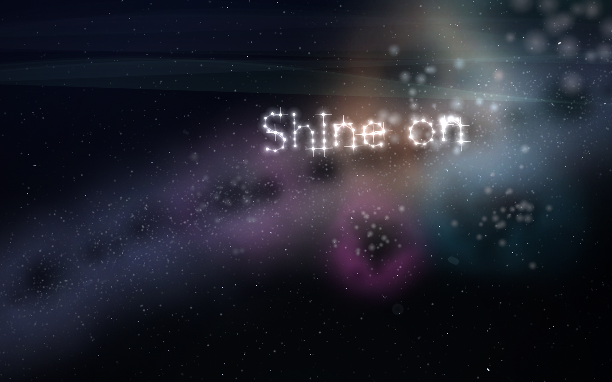
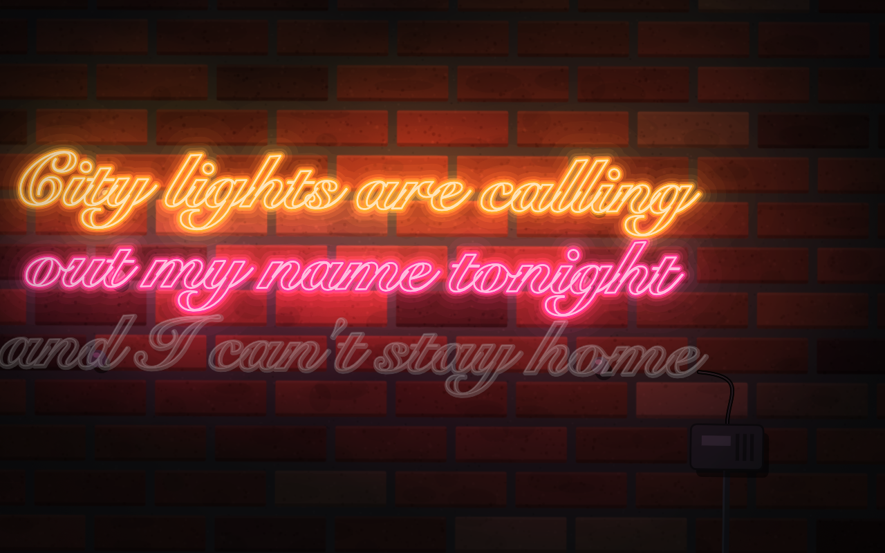
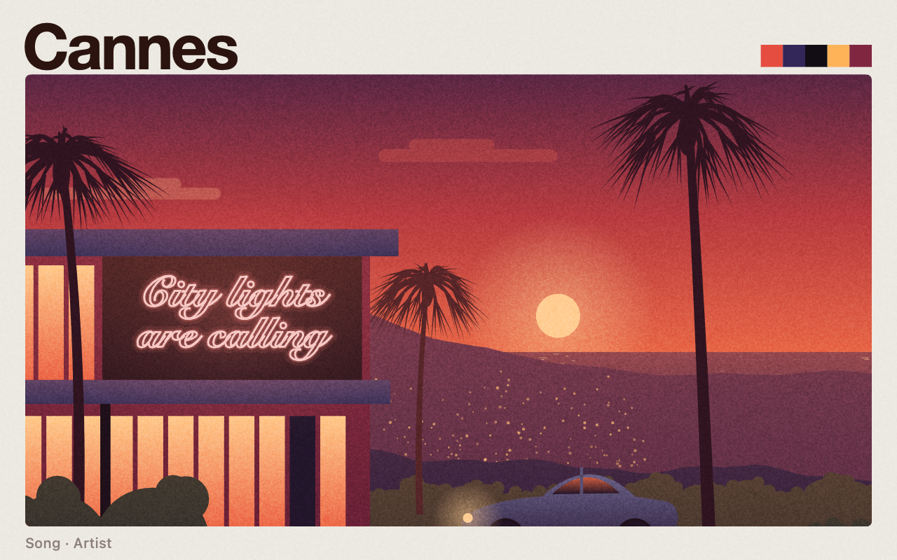
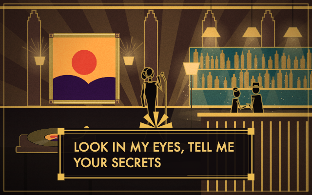
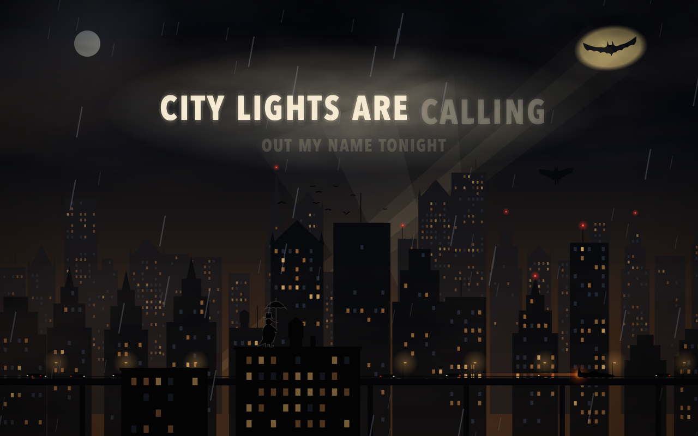
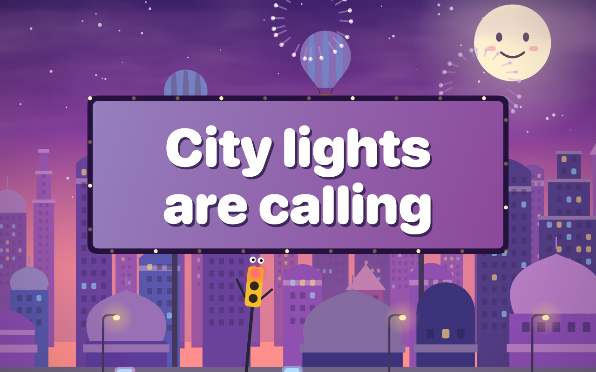
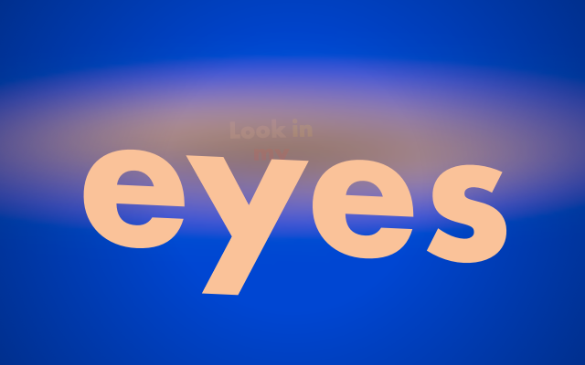
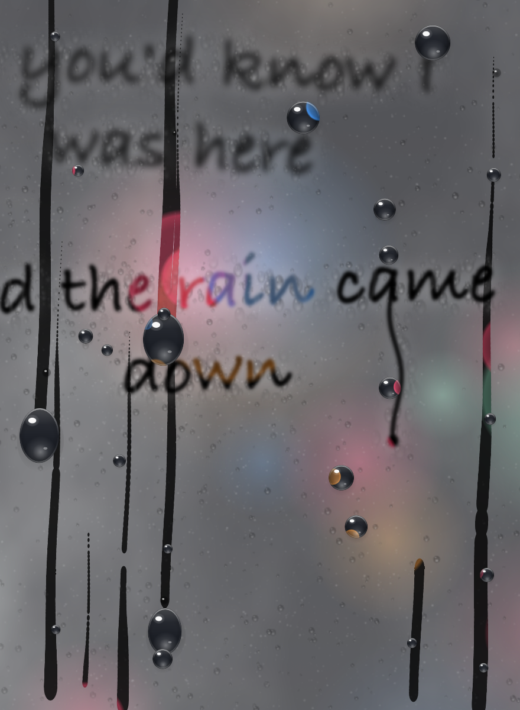

# LyricBubbles

**Lyrics for whatever Spotify is playing, in time with the song, in nine visual styles.**

LyricBubbles is a native macOS app built with SwiftUI. It follows the Spotify desktop app, fetches
time-synced lyrics from [LRCLIB](https://lrclib.net), and plays them back line by line, as a text
thread, a neon sign, a constellation, a retro poster and more. Each style opens in its own window
and works in full screen.

> LyricBubbles is an independent project. It is not made, endorsed or supported by Spotify or LRCLIB.

## Screenshots

Frames rendered from the app's own drawing code, with demo lyrics.

| Night Sky | Neon Sign | Postcards |
| --- | --- | --- |
|  |  |  |

| Megaverse | Gotham Night | Fever City |
| --- | --- | --- |
|  |  |  |

| Kinetic | Fogged Glass |
| --- | --- |
|  |  |

## Features

- **Nine styles**, each with its own window and settings:
  - **Messages**: lyrics as a live text thread, with reactions, effects and a glow that moves with the music.
  - **Fogged Glass**: each line written by fingertip into a steamy window, then breathed away.
  - **Neon Sign**: every part of the song is a neon sign on a brick wall at night.
  - **Gotham Night**: a searchlight throws each line onto the clouds above a rain-soaked city.
  - **Postcards**: each song becomes a retro travel poster that slowly comes alive.
  - **Night Sky**: words spelled in stars, coming toward you on an endless flight through deep space, with a warp into each chorus.
  - **Kinetic**: lines pop in word by word, then the biggest word flies at you.
  - **Megaverse**: each section cuts to a new scene: a deco lounge, a noir street, a comic stage.
  - **Fever City**: lyrics on billboards, blimps and skywriting over a toy-box city gone wild.
- **Real full screen** for every style (its own Space, Esc to leave). Messages scales to fill any
  display and aspect ratio.
- **Playback controls**: play/pause, previous and next for Spotify, as a small capsule in each
  style window. Per style: Off, On Hover (default) or Always. Also in the Playback menu and on the
  dashboard.
- **Group-chat singers**: Messages can split duets and features by singer, and you can fix who sings
  a part with a right-click.
- **React to music** (optional): system audio or microphone input drives the Messages glow and the
  beat effects in other styles. Audio is analysed live and never recorded or saved.
- **Lyric timing nudge** for when lyrics land early or late, for every song or just the one playing.
- **Float on Top** for style windows, and an option to open a style straight away at launch.

## Requirements

- macOS 15 (Sequoia) or later, on Apple silicon or Intel.
- The **Spotify desktop app** for Mac (not the web player), signed in and playing.
- An internet connection (lyrics are fetched from LRCLIB).
- To build: Xcode 16 or later, or the matching Command Line Tools (Swift 5.10+ with the macOS 15 SDK).

There are no third-party dependencies. The project is a plain Swift package (no Xcode project).

## Installation

### From a release

1. Download `LyricBubbles-<version>.dmg` (or `.zip`) from the
   [Releases](../../releases) page.
2. Drag **LyricBubbles** into **Applications**.
3. The app is ad-hoc signed and not notarized, so the first time macOS will refuse to open it.
   Click **Done**, then open **System Settings ▸ Privacy & Security**, find the message about
   LyricBubbles and click **Open Anyway**.
   If that option doesn't appear, run:
   ```bash
   xattr -dr com.apple.quarantine /Applications/LyricBubbles.app
   ```
4. When LyricBubbles asks to control Spotify, click **OK**. It needs this to read the current track
   and position, and to send play/pause/skip.

### From source

```bash
git clone https://github.com/jeff3-dev/LyricBubbles.git
cd LyricBubbles
./build.sh              # builds LyricBubbles.app (release) in the repo folder
open LyricBubbles.app
```

## Building

```bash
swift build             # debug build
swift test              # run the test suite
./build.sh              # release LyricBubbles.app next to the script
./build.sh --install    # also copies it to /Applications and opens it
./build.sh --dist       # universal (arm64 + x86_64) build, packed into dist/*.dmg and dist/*.zip
```

Set `VERSION` and `BUILD` at the top of `build.sh` before packaging a release.

## Usage

1. Play a song in Spotify.
2. Open LyricBubbles and pick a style on the dashboard.
3. Hover over a style window for the **Dashboard** and **Full Screen** buttons and the playback
   controls. The slider button at the top right opens that style's settings.

| Shortcut | Action |
| --- | --- |
| ⇧⌘M, ⇧⌘G, ⇧⌘N, ⇧⌘B, ⇧⌘P, ⇧⌘K, ⇧⌘J, ⇧⌘U, ⇧⌘C | Open Messages, Fogged Glass, Neon Sign, Gotham Night, Postcards, Night Sky, Kinetic, Megaverse, Fever City |
| ⇧⌘D | Back to the dashboard |
| ⇧⌘F / Esc | Enter / leave full screen |
| ⇧⌘T | Float on Top |
| ⌥⌘P | Play/Pause |
| ⌥⌘← / ⌥⌘→ | Previous / next track |
| ⌘[ / ⌘] | Show lyrics earlier / later |
| ⌥⌘[ / ⌥⌘] | Show this song's lyrics earlier / later (remembered per song) |
| ⌘, | Settings |

## Configuration

Everything is set in **Settings** (⌘,):

- **General**: which window opens at launch, Float on Top, lyric timing, and React to Music
  (source and sensitivity).
- **One pane per style**: grouped controls for that style's look and motion, with presets where
  the style has them. Each pane ends with the same **Playback** setting (Off, On Hover, Always).

Settings are stored in the app's user defaults (`local.lyricbubbles`).

## Permissions

| Permission | Why | Required |
| --- | --- | --- |
| Automation ▸ Spotify | Read the current track and position; play, pause and skip | Yes |
| System Audio Recording | React to Music with **System audio** | Only if you choose it |
| Microphone | React to Music with **Microphone** | Only if you choose it |

## Known limitations

- **Spotify desktop app only.** Apple Music, the Spotify web player and other players aren't supported.
- **No "Next Up".** Spotify's AppleScript interface can't read the play queue, and LyricBubbles
  doesn't use the Spotify Web API, so the upcoming track can't be shown.
- **Synced lyrics only.** Songs without time-synced lyrics on LRCLIB show a message instead.
- **Playback reads once a second.** After using Spotify's own controls, the app catches up
  within about a second. Its own buttons update immediately.
- **Not notarized.** Release builds are ad-hoc signed, so Gatekeeper asks for confirmation on first launch.
- Lyrics timing depends on LRCLIB's data; use ⌥⌘[ / ⌥⌘] to fix a song that's off.

## Credits and acknowledgments

- Lyrics: [LRCLIB](https://lrclib.net), a free, community-maintained database of synced lyrics.
- Playback information comes from the Spotify desktop app's AppleScript interface.
- Built with SwiftUI, AppKit, Core Text and Core Audio from Apple's macOS SDK.

Lyrics belong to their songwriters and publishers and are shown for personal use. Spotify is a
trademark of Spotify AB. LyricBubbles is not affiliated with Spotify or LRCLIB.

## License

Copyright © 2026 Jeff Sauls. All rights reserved.

The source is published so you can read it and build the app for yourself. No license is granted to
copy, modify or redistribute it.
